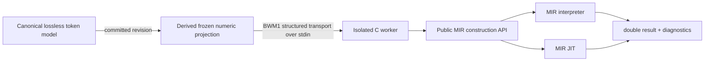

# Structured Workspace to in-memory MIR execution

## Result

The required vertical slice works. A committed Workspace revision is lowered
directly from its canonical token objects into an immutable numeric projection,
serialized as a bounded binary transport message, and used by a small C worker
to construct MIR through the pinned public C API. Both `MIR_interp_arr` and
MIR's native JIT execute the functions. The path does not render or re-lex
BASIC, and it creates no `.bas`, `.mir`, `.o`, or program executable.

The worker runs in a separate process for each invocation. The process boundary
provides a hard timeout for accidental recursion/nontermination and releases
all MIR state on exit. This costs roughly 0.7–1.0 ms per call in the measured
small corpus, including process startup. No executable cache is used, so a
revision can never accidentally use code from an earlier revision.

## Architecture



The projection reads token objects and existing token-to-symbol bindings. It
does not call `render_document()`, `lex()`, or the historic compiler. It is
read-only and revision-tagged. Every execution rebuilds it from the current
document and checks `expected_revision` before starting a worker. The binary
transport is not editable and is not a second source representation; it encodes
the projection's supported expression and assignment nodes for the C API.

The MIR worker creates prototypes and forward references first, defines all
functions, lowers expressions to typed double registers, links the module, and
then either calls `MIR_interp_arr` or generates and calls native code. MIR is
initialized and finalized within the worker. The host receives only a finite
double result, phase timings, or a structured diagnostic.

`ARCHITECTURE.md` records the API reconnaissance and boundary decision. The
worker can be rebuilt with `scripts/build-mir-worker.sh`.

## Worked revision example

Run:

```sh
experiments/basic-workspace/scripts/build-mir-worker.sh
PYTHONPATH=experiments/basic-workspace python3 experiments/basic-workspace/mir_execution_demo.py
```

The demo opens `SCALE(X)` and `APPLY(Y)` at revision 1, discovers their opaque
function and parameter IDs, and evaluates `SCALE(8)` as 18. It previews and
commits a semantic parameter rename to `POINTS` (revision 2), then renames
`SCALE` to `MULTIPLY_SHIFT` (revision 3). The original function identity
survives both changes, the bound call in `APPLY` is updated, and its result is
21. The source is rendered only at the end, on explicit request. No compiled
artifact is reused across the edits.

The RPC operation is `execute_function` with `document_id`,
`expected_revision`, a function ID first obtained through structure/symbol
discovery, numeric `arguments`, and `engine` (`interp` or `jit`). The server
rejects undiscovered identities and stale revisions.

## Supported projection

| Construct | Status | Notes |
|---|---|---|
| Numeric `FUNCTION` with up to 6 parameters | PASS | Default double mode; all parameters/results are `double`. |
| Numeric constants, variables, parentheses | PASS | Variables are bound through workspace symbol identities. |
| Unary `+` and `-`; `+ - * /` | PASS | Conventional arithmetic precedence. |
| Assignment to parameter/local/function result | PASS | Uninitialized locals and result begin at 0, matching the historic frontend behavior. |
| Numeric function call | PASS | Calls must target another function included in the same projection; up to 6 args. |
| Multiple functions and case-insensitive binding | PASS | Symbol identities, not text matching, determine bindings. |
| Basic line-number prefix | LIMITED | A numeric line label is recognized/ignored as a label; branching is not implemented. |
| `SUB`, strings, arrays, `IF`, `GOTO`, `GOSUB`, loops, DATA/READ, EXTERN, I/O, builtins | UNSUPPORTED | Rejected with diagnostics rather than lowered approximately. |
| Top-level statements | UNSUPPORTED | Projection consists only of function definitions. |
| Non-finite constants/arguments/results | REJECTED | Avoids JSON and host ABI ambiguity. |

The service accepts only numeric arguments and finite double results. It does
not expose external imports or runtime I/O. Worker limits bound input size,
function count, arity, locals, statements, and expression nesting. The 2-second
worker timeout terminates both interpreter and JIT runs. This is a constrained
execution surface, not a general sandbox for arbitrary BASIC or arbitrary MIR.

## Differential validation

Command:

```sh
experiments/basic-workspace/scripts/build-mir-worker.sh
PYTHONPATH=experiments/basic-workspace python3 experiments/basic-workspace/scripts/validate-mir-execution.py
```

The script creates a temporary BASIC file only for the historical compiler
oracle and cleans the temporary directory automatically. The workspace arm
executes from its in-memory model. Four fixtures were run through the historic
interpreter, historic JIT, structured MIR interpreter, and structured MIR JIT:

| Fixture | Result | Historic interpreter | Historic JIT | MIR interpreter | MIR JIT |
|---|---:|---|---|---|---|
| Precedence, parentheses, unary negative | -7 | PASS | PASS | PASS | PASS |
| Local variable and arithmetic | 2 | PASS | PASS | PASS | PASS |
| Multiple functions and function call | 21 | PASS | PASS | PASS | PASS |
| Case-insensitive binding, negative argument | 10 | PASS | PASS | PASS | PASS |

All outputs matched exactly at the printed integer-valued doubles. The machine
record is `differential.json`. Unit tests additionally cover semantic parameter
and function renames, stable function IDs, stale revision rejection, invalid
argument counts through the service, explicit unsupported-syntax rejection,
multiple calls, and a guard that fails if execution renders or re-lexes BASIC.

## Measurements

Run:

```sh
PYTHONPATH=experiments/basic-workspace python3 experiments/basic-workspace/scripts/benchmark-mir-execution.py
```

Skip, native Linux x86-64, 9 numeric functions / 439 source characters, one
warm-up then 30 fresh worker processes per engine. Each invocation rebuilt and
released its MIR context. `benchmark.json` contains all sample summaries.

| Phase (ms) | MIR interpreter median (p95) | MIR JIT median (p95) |
|---|---:|---:|
| Workspace open + indexing, one measurement | 0.455 | 0.455 |
| Projection | 0.217 (0.275) | 0.199 (0.253) |
| Binary serialization | 0.028 (0.037) | 0.027 (0.036) |
| MIR build | 0.119 (0.201) | 0.113 (0.130) |
| MIR link | 0.057 (0.097) | 0.379 (0.435) |
| MIR JIT compile | N/A | 0.0011 (0.0011) |
| Invocation | 0.0052 (0.0085) | 0.00015 (0.00021) |
| Whole worker process | 0.679 (1.050) | 0.992 (1.129) |

The timings are small-fixture measurements, not an end-user speed comparison.
JIT invocation is faster after the one-time worker/module setup, but this
prototype creates a fresh worker for each call. Worker peak RSS was about
17.6 MiB (maximum 17,952 KiB). Native worker exit releases MIR resources;
workspace documents do not retain native allocations. The service currently
has no revision cache, so there are no cache-hit measurements.

## Tests and reproducibility

Commands run:

```sh
experiments/basic-workspace/scripts/build-mir-worker.sh
PYTHONPATH=experiments/basic-workspace python3 -m unittest discover -s experiments/basic-workspace/tests -v
PYTHONPATH=experiments/basic-workspace python3 experiments/basic-workspace/scripts/validate-mir-execution.py
PYTHONPATH=experiments/basic-workspace python3 experiments/basic-workspace/scripts/benchmark-mir-execution.py
PYTHONPATH=experiments/basic-workspace python3 experiments/basic-workspace/mir_execution_demo.py
experiments/basic-workspace/scripts/validate-dialect.sh
```

The full Python suite contains 45 tests, including the original Workspace and
LLM-harness tests. The final pass count is recorded in the completion report.
Generated worker binaries and Python bytecode are ignored. The `.bas` reference
file is under a unique `/tmp/atlas-basic-mir-reference-*` directory and is
removed by `TemporaryDirectory` on success or failure.

## Answers to the architectural questions

1. **Can the workspace model directly produce executable MIR?** Yes, via a
   derived frozen projection and the public MIR C construction APIs.
2. **Does it avoid BASIC rendering and reparsing?** Yes; a test patches both
   `render_document` and the lexer to fail if invoked during execution.
3. **What structured intermediate was needed?** A compact expression tree and
   ordered assignment list with bound symbol IDs, transported as `BWM1`.
4. **How much duplicate semantics?** The projection implements a small numeric
   expression grammar, function boundaries, variable slots, zero initialization,
   and numeric calls. It intentionally duplicates no control-flow/runtime
   semantics.
5. **How close to historic execution?** Four selected arithmetic/call fixtures
   match interpreter and JIT exactly. This is evidence only for that subset.
6. **Which edits recompile safely?** Supported variable and function renames
   are reindexed and lowered from the next committed revision; identity stays
   stable. There is no compiled-artifact cache to invalidate.
7. **How expensive is a new revision?** Projection about 0.20 ms median,
   worker setup/build/link about 0.68 ms interpreter or 0.99 ms JIT median on
   the measured small module, plus process startup included in worker time.
8. **What is needed for larger programs?** Incremental projection and/or a
   persistent worker/cache, then carefully specified control-flow lowering,
   runtime contracts, arrays, strings, and side effects. These are separate
   semantic features, not just MIR opcodes.
9. **Is a shared historic frontend justified?** Not yet. The C frontend's
   parser/arena/global state remains tightly coupled; this vertical slice is
   small and differential evidence is limited. A narrow shared expression
   grammar or parser API could be evaluated after subset expansion.
10. **Smallest next step for Atlas dynamic components?** Add a trusted-fixture
    execution tool returning result and diagnostics for this numeric subset,
    backed by the isolated worker and pinned MIR version. Keep arbitrary
    programs in a separately resource-limited worker and do not grant native
    imports or host I/O.

## Remaining limitations

- Only numeric function bodies with simple assignments are compiled; control
  flow and top-level BASIC are explicit errors.
- Only up to six numeric parameters/call arguments are supported.
- Each call starts a native worker; no context/JIT cache exists.
- The interpreter/JIT comparison covers four hand-selected fixtures, not the
  historical BASIC corpus.
- There is no full OS memory/CPU quota; the worker enforces format limits and
  a wall-clock timeout. This is not a security sandbox for hostile MIR.
- No MADC, MIR, historical BASIC compiler, or AOT code was changed.
